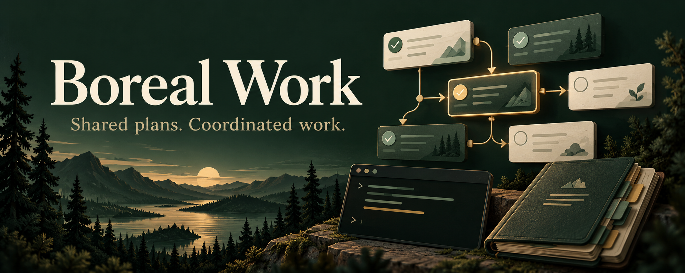
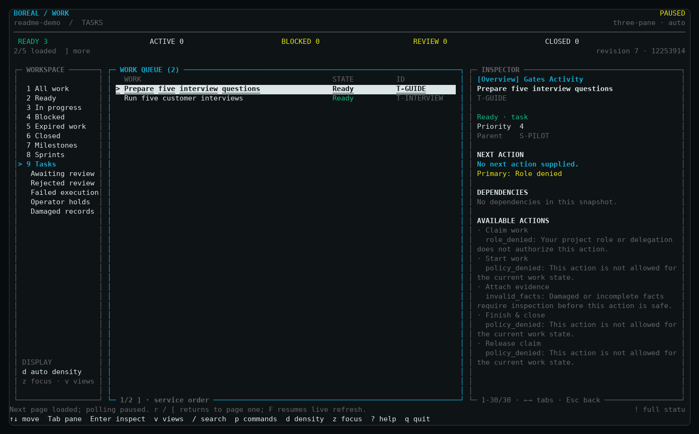

# Boreal Work



**Local-first project management for people and AI agents.**

Keep everyday plans, business projects, and agent-assisted work organized in one place. See what needs attention, give each task a clear owner, and carry the evidence and context forward when the work changes hands.

[Get started](#get-started) · [Agent workflows](#coordinate-project-work) · [MCP setup](crates/mcp/README.md) · [Documentation](#documentation)

## From the big picture to the next task

**Global is your portfolio.** Manage personal and business projects, tasks, milestones, and notes from any directory. Projects can be folderless, associated with a folder, or linked to an existing Boreal execution workspace. Custom statuses, priorities, due dates, and relationships help keep the wider picture useful.

**Project is your execution workspace.** Break work into milestones, sprints, and tasks with dependencies and explicit ownership. People and agents work through the same lifecycle: find ready work, claim an attempt, record progress, attach evidence, and finish or hand it off. Required reviews and evidence determine whether work can close and unblock its dependents.

Sources, handoff summaries, and curated project memory keep the reasoning behind the work available for the next person or agent.

## Get started

The prebuilt installer supports **Apple Silicon macOS and x86_64 Linux**. Install **Node.js 20–26** before opening either dashboard; CLI commands work without Node.js.

```sh
curl -fsSL https://raw.githubusercontent.com/mattrichmo/boreal-work/refs/heads/main/install.sh | sh -s -- --yes
export PATH="$HOME/.local/bin:$PATH"
bwrk --version
```

This installs the latest compatible release under `~/.local`, verifies its archive against `SHA256SUMS`, and creates your separate local Global store. Add `~/.local/bin` to your shell's PATH if it is not already there.

### Create your first project

Start with a small plan that needs no repository or project folder:

```sh
bwrk global project add --name "Weekend plans" --json
```

Copy the returned `data.id`. Replace `PROJECT_ID` below with that value:

```sh
bwrk global task add --project PROJECT_ID --title "Choose a hiking trail"
bwrk global note add --project PROJECT_ID --title "Trail ideas" --body "Look for a short loop with a good picnic spot."
bwrk dashboard global
```

You now have a project, a task, and a note in your local portfolio. Open “Weekend plans” in the dashboard to explore them. Press `?` for help and `q` to quit.

See [installation and updates](docs/INSTALL.md) for pinned releases, archive verification, and source builds.

## Coordinate project work

When a project needs structured execution and agent handoffs, initialize its working folder:

```sh
cd your-project
bwrk init --agents codex,claude --yes
bwrk doctor
bwrk agent guide --json
bwrk dashboard
```

Setup creates the project record, memory layout, and selected agent skills. An empty project has no claimable work until its plan is created and launched.

- **Plan:** organize milestones, sprints, tasks, and dependencies.
- **Coordinate:** use contextual guidance and ready-work selection so agents can claim distinct tasks.
- **Verify:** retain progress, evidence, and review decisions with each attempt.
- **Hand off:** save summaries and publish curated knowledge for the next session.

Start with [packaged workflows](docs/WORKFLOWS.md) and the [CLI workflow reference](docs/CLI_WORKFLOWS.md). [Local orchestration](docs/CLI_ORCHESTRATION.md) adds explicitly configured worker dispatch; installing Boreal alone does not launch agents.

## Three ways to work

- **Terminal dashboards:** use `bwrk dashboard global` for the portfolio and `bwrk dashboard` inside an initialized project.
- **CLI:** inspect and automate workflows with structured JSON output. `bwrk commands` lists available routes; `bwrk help work create` shows command-specific syntax.
- **MCP:** connect compatible agent clients to scoped Global reads and authorized Project operations through Boreal's local services.

**MCP is available on current `main`, after the published v0.2.1 release.** Use the [source-build installer](docs/INSTALL.md#source-build-fallback) for these commands, then follow the [MCP guide](crates/mcp/README.md) for client compatibility, configuration, and permissions. Global MCP access is read-only; Project writes are separately scoped.

The source installer compiles the CLI and both dashboards. A bare `cargo install --path crates/cli --bin bwrk --locked` builds the Rust executable, including current-main MCP commands, but does not package the dashboards.

<details>
<summary>See the project dashboard</summary>



An earlier development build with synthetic demo data. See [capture details](docs/README-CAPTURE-NOTES.md).

</details>

## Your data stays under your control

- **Global:** a separate per-user SQLite store holds your portfolio and notes. It survives reinstalling the application.
- **Project:** ignored `.boreal/` files hold local configuration, credentials, operational data, and runtime state. Curated notes live in `memory/`, with a separate Git repository by default.
- **Connections:** dashboards use local Unix-socket services. No Boreal-hosted account or cloud-sync setup is required. Configured agents, evidence commands, and MCP HTTP integrations may use the network.
- **History:** failed evidence and interrupted attempts remain part of the record.

See [data locations and setup](docs/INSTALL.md), [operations and recovery](docs/CLI_OPERATIONS.md), and [security boundaries](docs/SECURITY.md).

## Platforms and current limits

Boreal Work v2 is under active development. Published v0.2.1 archives cover Apple Silicon macOS and x86_64 Linux; source builds also support Intel macOS. Windows and Linux ARM64 are not currently supported. Dashboards require Node.js 20–26.

Features can differ between releases and `main`. Use `bwrk commands` to check your installed build.

## Documentation

- [Install and update](docs/INSTALL.md)
- [Workflows](docs/WORKFLOWS.md) · [CLI reference](docs/CLI_WORKFLOWS.md)
- [Agent orchestration](docs/CLI_ORCHESTRATION.md) · [Sources and memory](docs/CLI_KNOWLEDGE.md)
- [MCP integration](crates/mcp/README.md)
- [Operations and recovery](docs/CLI_OPERATIONS.md) · [Security](docs/SECURITY.md)
- [Architecture](docs/ARCHITECTURE.md) · [Build checks](docs/BUILD.md)
- [Legacy migration](docs/MIGRATION.md)

[MIT license](LICENSE).

