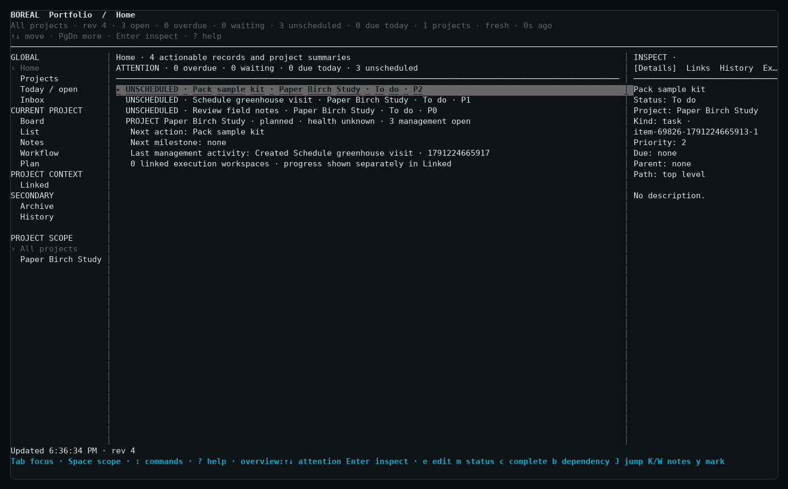
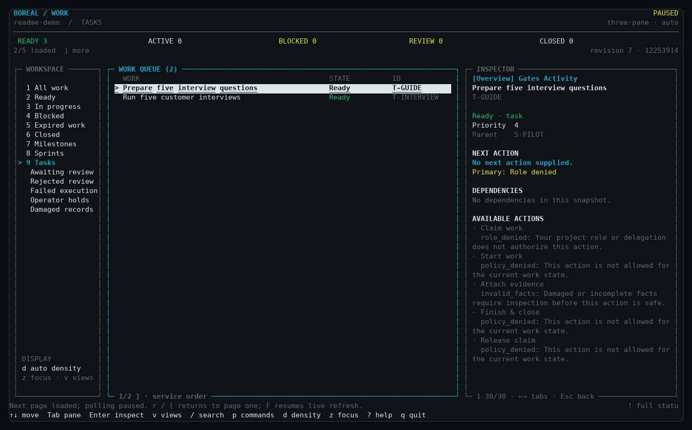

# Boreal Work

Boreal Work is a local project manager for personal plans, ongoing projects, and
work shared with AI agents. Use the terminal dashboards to organize tasks and notes,
review progress, and see what needs attention. Use the CLI for individual commands,
scripts, and repeatable workflows against the same project data.

There are two workspaces: **Global** keeps track of your projects and everyday tasks;
**Project** manages work that needs dependencies, assigned ownership, evidence, and
review before it is complete. A Global project can exist without a folder or repository.

[Global dashboard](#global-dashboard) · [Project dashboard](#project-dashboard) ·
[CLI examples](#cli-examples) · [Working with agents](#working-with-agents) ·
[Documentation](#documentation)

## Global dashboard

See tasks across projects, keep notes alongside a plan, and switch between board and
list views. Add priorities, due dates, labels, and custom workflow statuses. Use the
inbox for work that has not yet been assigned to a project.



*Earlier development capture with fictional Paper Birch Study data. The current
layout may differ; see [capture details](docs/README-CAPTURE-NOTES.md).*

Open the Global terminal dashboard from any directory:

```sh
bwrk dashboard global
```

In a task view:

- Press `n` to capture a task or `N` for the detailed form.
- Press `Enter` to inspect a selected item and `e` to edit it.
- Press `s` to choose a project, or `Space` to switch between all projects and your
  last selected project.
- Press `?` for the current view's help and `q` to quit.

Global tasks have their own completion state. Linking a Global project to a Project
workspace shows that workspace's progress separately.

## Project dashboard

Use a Project workspace when a plan needs milestones, sprints, dependent tasks, or
reviewed results. The dashboard shows the work queue and a detail panel for the
selected item, including its current state, requirements, and available actions.



*Earlier development capture with fictional tasks. The demo session has no permission
to claim work, so those actions are disabled. See [capture details](docs/README-CAPTURE-NOTES.md).*

From an existing Project workspace, open its terminal dashboard:

```sh
bwrk dashboard
```

Use the numbered views to find ready, active, blocked, or closed work. Press `/` to
search, `Enter` for details, `?` for help, and `q` to quit. Available actions depend on
your role and the work item's state.

### Plan, carry out, and review work

1. **Plan the work.** Arrange milestones, sprints, and tasks. Record dependencies and
   the evidence or review a task needs before it can close.
2. **Choose the next task.** See what is ready, who owns an active attempt, and what
   is blocking other work.
3. **Record the result.** Keep progress, evidence, and review decisions with the work.
   Closing a task follows its requirements before it can unblock dependent tasks.
4. **Leave context for the next session.** Save a handoff summary, retain source
   material, and publish useful project notes.

The dashboard covers the queue, inspection, and supported work actions. Planning and
other operations also have CLI workflows; see the [workflow guide](docs/WORKFLOWS.md)
and [command reference](docs/CLI_WORKFLOWS.md).

## CLI examples

### Keep a small plan in Global

Create a folderless project:

```sh
bwrk global project add --name "Weekend plans" --json
```

Copy `data.id` from the response and use it in place of `PROJECT_ID` below:

```sh
bwrk global task add --project PROJECT_ID --title "Choose a hiking trail"
bwrk global note add --project PROJECT_ID --title "Trail ideas" --body "Look for a short loop with a picnic spot."
bwrk global task list --project PROJECT_ID --json
```

The same project, task, and note appear in the Global dashboard. Global commands work
from any directory.

### Inspect an existing Project workspace

Run these from a Project workspace, replacing `PROJECT` with its execution project ID.
This is separate from a Global project's ID.

```sh
bwrk work list --project PROJECT --json
bwrk work ready --project PROJECT --json
bwrk work list --project PROJECT --status blocked --json
```

The ready-work list is specific to the current caller's permissions. Use the work
details and workflow guidance to check what an action requires before changing it.

### Find a command

```sh
bwrk commands
bwrk help work create
bwrk help work claim
```

Commands with `--json` return structured results for scripts and integrations. The
command list reflects your build; see [CLI workflows](docs/CLI_WORKFLOWS.md) for
planning, handoffs, templates, history, and exports.

## Working with agents

Agents use the same project records and work requirements as people. They can inspect
available work, claim a task, record evidence, and leave a summary for the next session.
An active attempt records ownership, and required evidence and reviews still apply
before the task can close.

The CLI provides contextual guidance through `bwrk agent guide`. Optional
[local orchestration](docs/CLI_ORCHESTRATION.md) can dispatch explicitly configured
workers; Boreal does not launch agents on its own.

[MCP integration](crates/mcp/README.md) is available in current `main`, after the
published v0.2.1 release. It exposes read-only Global access and separately authorized
Project operations to compatible clients. See that guide for supported clients and
permission scopes.

## Local data and history

- **Global** stores your portfolio and notes in a separate per-user SQLite database.
- **Project** keeps local configuration, operational records, credentials, and runtime
  state in its ignored `.boreal/` directory. Curated notes live in `memory/`, with a
  separate Git repository by default.
- **Dashboards** connect to local services over Unix sockets. No Boreal-hosted account
  or cloud sync is required. Configured agents, evidence commands, and MCP HTTP
  integrations may use the network.
- **History** retains failed evidence and interrupted attempts as well as completed work.

See [operations and recovery](docs/CLI_OPERATIONS.md) and
[security boundaries](docs/SECURITY.md) for backups, recovery, and access rules.

## Documentation

- [Setup and updates](docs/INSTALL.md)
- [Workflows](docs/WORKFLOWS.md) · [CLI reference](docs/CLI_WORKFLOWS.md)
- [Project terminal dashboard](apps/tui/README.md) · [Global terminal dashboard](apps/global-tui/README.md)
- [Sources and project notes](docs/CLI_KNOWLEDGE.md) · [Agent orchestration](docs/CLI_ORCHESTRATION.md)
- [MCP integration](crates/mcp/README.md)
- [Operations and recovery](docs/CLI_OPERATIONS.md) · [Security](docs/SECURITY.md)
- [Architecture](docs/ARCHITECTURE.md) · [Build checks](docs/BUILD.md)
- [Legacy migration](docs/MIGRATION.md)

[PolyForm Noncommercial 1.0.0 license](LICENSE).
